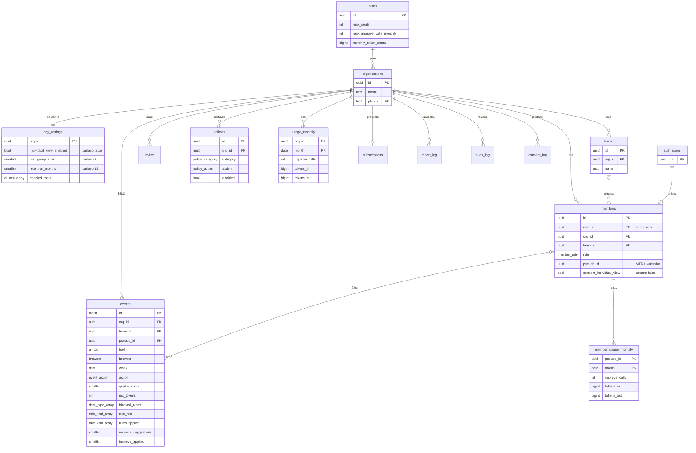

# ERA model baze

Cijela shema za Supabase, od Faze 5 do Faze 11 iz `docs/PROMPTS.md`. SQL je u jednoj datoteci: `supabase/migrations/20261102120000_chatify_schema.sql`.

Status: **nacrt za pregled u timu**. Shema je isprobana na Postgresu 16 (vidi "Što je provjereno").

## Glavna načela

- **Nema imena, prezimena ni e-pošte** ni u jednoj našoj tablici. Osoba je samo **šifra** (`members.pseudo_id`, nasumični UUID). Podaci za prijavu ostaju u Supabase Authu (`auth.users`), koji mi ne kopiramo ni ne prikazujemo.
- **Nema teksta prompta** (pravilo 2). Tablica `events` ima samo ID-jeve, enume, brojeve i datume.
- **Firma A ne vidi firmu B** (pravilo 8). RLS je uključen na svih 16 tablica.
- **Ploča vidi samo zbrojeve.** Sirovi događaji se ne čitaju; sve ide kroz funkcije koje skrivaju male skupine.
- **Pregled po osobi** (pravilo 6) traži **oboje**: da ga firma uključi i da zaposlenik sam da pristanak. Svaki takav pregled se bilježi.

## Dijagram

Uz to postoje i `invites`, `consent_log`, `audit_log`, `adapter_rules`, `subscriptions`, `billing_events` i `report_log` (opisane niže).

## Tablice

| Tablica | Svrha | Faza |
| --- | --- | --- |
| `plans` | cjenik: mjesta, "Poboljšaj" pozivi i kvota tokena mjesečno | 5, 10 |
| `organizations` | firma | 5 |
| `org_settings` | privatnost, minimalna skupina, rok čuvanja, alati, tjedni izvještaj | 5, 7 |
| `teams` | timovi u firmi | 5 |
| `members` | osoba u firmi: uloga, tim i **šifra** (`pseudo_id`) | 5 |
| `consent_log` | dokaz o pristanku (GDPR čl. 7), samo šifra | 5 |
| `invites` | pozivni kodovi (bez e-pošte, admin sam šalje kod) | 5 |
| `events` | jedan redak po promptu, samo brojevi i vrste | 5 |
| `policies` | pravilo po kategoriji podataka (zamijeni, blokiraj, upozori) | 3, 7 |
| `usage_monthly` | "Poboljšaj" pozivi i stvarni tokeni po firmi i mjesecu | 6 |
| `member_usage_monthly` | isto po šifri korisnika | 6 |
| `adapter_rules` | pravila za pronalaženje polja za unos kao JSON podaci | 8 |
| `subscriptions`, `billing_events` | pretplata i zaštita od dvostruke obrade webhooka; bez podataka o karticama | 10 |
| `report_log` | koji tjedni izvještaj je poslan | 7 |
| `audit_log` | tko je što promijenio (šifra, ne ime) | 11 |

## Što bilježi jedan događaj (`events`)

| Stupac | Primjer | Značenje |
| --- | --- | --- |
| `tool`, `browser` | `chatgpt`, `edge` | gdje je prompt napisan |
| `action` | `sent`, `replaced`, `edited`, `sent_anyway`, `blocked`, `improve_requested` | što je korisnik napravio |
| `quality_score` | 72 | ocjena prompta 0–100 |
| `est_tokens` | 340 | **procjena** tokena iz duljine teksta |
| `blocked_types`, `blocked_count` | `{oib,iban}`, 2 | koje vrste osjetljivih podataka i koliko |
| `rule_hits`, `rules_applied` | `{vague,no_format}`, `{vague}` | koje provjere su se upalile i koje je korisnik ispravio |
| `improve_suggestions`, `improve_applied` | 4, 3 | prijedlozi "Poboljšaj" i koliko ih je primijenjeno |

Firmu, tim i šifru **ne šalje ekstenzija**. Baza ih sama upisuje iz prijavljenog korisnika, pa ih nitko ne može lažirati.

## Funkcije

| Funkcija | Tko | Što vraća |
| --- | --- | --- |
| `create_organization(ime, tim)` | novi korisnik | nova firma; stvaratelj postaje admin, dobiva zadana pravila |
| `create_invite(firma, tim, uloga, broj, dani)` | admin | pozivni kod |
| `redeem_invite(kod)` | novi korisnik | ulazak u firmu (provjerava broj mjesta u planu) |
| `set_individual_consent(da/ne)` | zaposlenik | pristanak za pregled po osobi |
| `delete_my_data()` | zaposlenik | brisanje (GDPR čl. 17); prošli događaji ostaju samo kao anonimni brojevi |
| `my_policies(alat)` | ekstenzija | pravila koja vrijede za mene |
| `check_improve_quota()`, `record_improve_usage(in, out)` | Worker | smije li se zvati model; bilježi tokene i javlja kad firma prijeđe 80 % |
| `org_overview(firma, dani)` | admin | KPI kartice: aktivni korisnici, promptovi, tokeni, kvaliteta, zaustavljeni podaci, postotak ispravaka, procjena uštede vremena |
| `team_weekly_stats(firma)` | admin | po timu i tjednu: promptovi, tokeni i **udio tokena u %**, kvaliteta, zaustavljeno po kategoriji, provjere po vrsti, ispravci |
| `member_weekly_stats(firma)` | admin | isto **po šifri**, samo uz uključenu postavku i pristanak; svaki poziv se bilježi |
| `org_usage(firma)` | admin | iskorišteno mjesta, poziva i tokena ovaj mjesec **u postotku plana** |
| `my_weekly_stats()`, `my_usage()` | zaposlenik | moje brojke i moj udio u tokenima (pravo na pristup) |
| `purge_expired_data()` | cron (service role) | briše stare događaje prema roku čuvanja |

## GDPR

| Načelo | Kako ga shema provodi |
| --- | --- |
| Smanjenje količine podataka | bez imena, e-pošte i teksta prompta; pozivi bez e-pošte |
| Pseudonimizacija | osoba je samo nasumična šifra |
| Skrivanje malih skupina | tim ili firma s manje od 3 aktivne osobe (`min_group_size`) ne prikazuje brojke; mali timovi se spajaju u "ostali" |
| Pristanak | samo zaposlenik ga mijenja; admin ne može (zabranjeno na razini stupca); svaka promjena ide u `consent_log` |
| Pravo na pristup | `my_weekly_stats()`, `my_usage()` |
| Pravo na brisanje | `delete_my_data()`; račun za prijavu nakon toga briše Worker |
| Ograničenje pohrane | `purge_expired_data()`: događaji nakon 12 mjeseci (3–24, po firmi), zapisi o reviziji nakon 24 mjeseca |
| Odgovornost | `audit_log` bilježi promjene pravila, postavki, uloga i svaki pregled po osobi |
| Podaci u EU-u | Supabase projekt u regiji **Central EU (Frankfurt)** |

Service role ključ koristi se samo za webhook naplate, tjedni izvještaj, brisanje računa i `purge_expired_data` (pravilo 8).

## Što je provjereno

Shema je pokrenuta na Postgresu 16 s istim zadanim dozvolama kao Supabase. Prošlo je:

- firma A ne vidi i ne može mijenjati ništa od firme B (statistika, potrošnja, članovi)
- ekstenzija ne može podmetnuti tuđu firmu ni šifru; član ne čita sirove događaje
- tim ili firma s 1 osobom ne prikazuje brojke
- pregled po osobi je isključen dok firma ne uključi postavku **i** zaposlenik ne da pristanak; admin ne može dati pristanak umjesto zaposlenika; svaki pregled je zabilježen
- postoci potrošnje, kvota "Poboljšaj" i ograničenja tokena
- zadnji admin se ne može ukloniti; brisanje korisnika ostavlja samo anonimne brojeve
- anonimni korisnik nema pristup ničemu; stari događaji se brišu
- `events` nema nijedan tekstualni stupac, a nijedna tablica nema ime ili e-poštu osobe

To nije zamjena za prave testove `supabase test db` iz Faze 5.

## Otvorena pitanja za tim

1. **Formula uštede vremena** (`est_minutes_saved`) je privremena: 0,5 min po primijenjenoj provjeri i 1 min po primijenjenom prijedlogu "Poboljšaj". Treba je potvrditi.
2. **Vrijednosti planova** (mjesta, pozivi, tokeni) su privremene.
3. **Jedna firma po korisniku?** Predloženo da.
4. **Supabase Auth i imena:** prijava preko Googlea ili Microsofta sama sprema ime i e-poštu u `auth.users`. To treba spomenuti u politici privatnosti.
5. Nove funkcije koje se kasnije dodaju u Supabase automatski dobivaju dozvolu za anonimne korisnike; svaku treba ručno zatvoriti (vidi odjeljak 17 u SQL-u).
