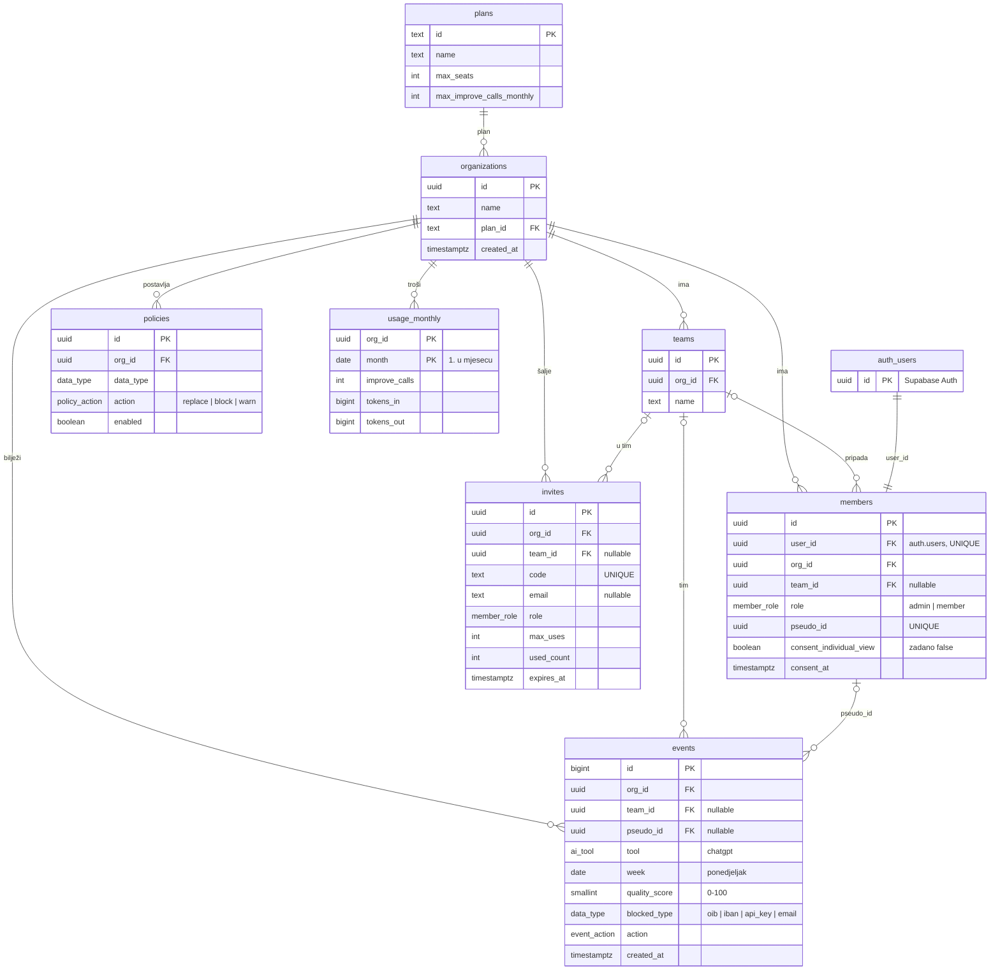

# ERA model baze (prijedlog za Fazu 5)

Prijedlog sheme za Supabase prema `docs/ARCHITECTURE.md` (odjeljak 6) i pravilima 2, 6 i 8 iz `CLAUDE.md`. SQL je u `supabase/migrations/20261101000000_init_schema.sql`.

Status: **nacrt za pregled**. Shema je isprobana na lokalnom Postgresu 16 (vidi "Što je provjereno"), ali još nije pregledana u timu.

## Dijagram

GitHub ovaj dijagram prikazuje kao sliku. U VS Codeu treba ekstenzija za Mermaid pregled.

## Entiteti

| Tablica | Što je | Ključni stupci |
| --- | --- | --- |
| `plans` | cjenik planova, zajednički za sve | `max_seats`, `max_improve_calls_monthly` |
| `organizations` | firma (kupac) | `plan_id` |
| `teams` | tim unutar firme (Prodaja, IT…) | `org_id`, `name` (jedinstven u firmi) |
| `members` | korisnik u firmi | `user_id`, `role`, `pseudo_id`, `consent_individual_view` |
| `invites` | pozivni kod za ulazak u firmu | `code`, `expires_at`, `max_uses` |
| `events` | agregirani događaj iz ekstenzije | `tool`, `week`, `quality_score`, `blocked_type`, `action` |
| `policies` | pravilo firme po vrsti podatka | `data_type`, `action`, `enabled` |
| `usage_monthly` | potrošnja "Poboljšaj" po firmi i mjesecu | `improve_calls`, `tokens_in`, `tokens_out` |

## Veze

- Firma ima više timova, članova, poziva, događaja, pravila i mjesečnih zapisa potrošnje. Brisanjem firme briše se sve njezino (`on delete cascade`).
- Član pripada **jednoj** firmi (u prvoj verziji) i najviše jednom timu.
- Tim člana, poziva i događaja **mora biti iz iste firme**. To osigurava baza (složeni strani ključ `(team_id, org_id)`), ne samo kod.
- Događaj je vezan uz člana samo preko `pseudo_id`, nikad preko `user_id` ili e-pošte.

## Zašto je ovako (veza s pravilima)

| Pravilo | Kako ga shema provodi |
| --- | --- |
| 2: bez teksta prompta | `events` nema nijedan tekstualni stupac. Sve su enumi, brojevi, datumi i ID-jevi, pa tekst prompta fizički ne stane u tablicu. |
| 2: samo vrsta podatka | `blocked_type` je enum (`oib`, `iban`, `api_key`, `email`), nikad sama vrijednost. |
| 6: pregled po osobi uz pristanak | `consent_individual_view` je zadano `false`; ako je `true`, mora postojati `consent_at`. |
| 8: izolacija firmi | RLS je uključen na **svakoj** tablici. Pomoćne funkcije `is_org_member()` i `is_org_admin()`. |
| Ploča vidi samo zbrojeve | Nitko ne čita sirove `events`. Admin poziva `team_weekly_stats(org)` koja vraća samo zbrojeve po timu i tjednu. |

Dodatne provjere u bazi: `week` mora biti ponedjeljak, `month` prvi dan u mjesecu, `quality_score` između 0 i 100, a radnje `replaced`, `edited`, `sent_anyway` i `blocked` moraju imati `blocked_type`.

## Tko što smije (RLS)

| Tablica | Član | Admin firme | Druga firma |
| --- | --- | --- | --- |
| `plans` | čita | čita | čita (javni cjenik) |
| `organizations` | čita svoju | čita, mijenja ime | ništa |
| `teams` | čita | sve | ništa |
| `members` | čita samo sebe | čita i uređuje svoje članove | ništa |
| `invites` | ništa | sve | ništa |
| `events` | samo upisuje **za sebe** | samo preko `team_weekly_stats` | ništa |
| `policies` | čita | sve | ništa |
| `usage_monthly` | ništa | čita | ništa |

## Što je provjereno

Migracija je pokrenuta na Postgresu 16 sa zamjenom za Supabase Auth (`auth.users`, `auth.uid()`, uloge `anon` i `authenticated`). Prošlo je:

- član firme A **ne može** upisati događaj u firmu B ni lažno se predstaviti kao drugi član
- admin firme A vidi samo svoju firmu i svoje članove, a za firmu B dobiva 0 redaka
- admin firme A ne može promijeniti ime firme B
- obični član ne vidi sirove događaje ni statistiku, a admin vidi zbrojeve za svoj tim
- tim iz druge firme, radnja bez vrste podatka i tjedan koji nije ponedjeljak su odbijeni

To **nije** zamjena za prave testove (`supabase test db`) iz Faze 5, koji trebaju pokriti svaku tablicu.

## Ostaje za Fazu 5

- RPC funkcije: `create_organization` (stvaratelj postaje admin), `redeem_invite(code)`, `set_individual_consent(bool)`, `increment_usage(...)` za Worker
- pregled po osobi za članove s pristankom
- RLS testovi za svaku tablicu (`supabase test db`) i generirani TypeScript tipovi

## Otvorena pitanja za tim

1. **Jedna firma po korisniku?** Predloženo da (`user_id` je jedinstven). Konzultant u više firmi bi trebao drugačiji model.
2. **Najmanji broj ljudi u statistici?** Tim od 1 do 2 osobe u zbroju praktički otkriva pojedinca. Predlažemo ne prikazivati redak kad je `active_users < 3`.
3. **Koliko dugo čuvamo događaje?** Prijedlog: 12 mjeseci, zatim brisanje (dobro za GDPR i besplatnih 500 MB).
4. **Vrijednosti planova** (`pilot`, `starter`, `pro`) su privremene i služe samo da ograničenja postoje od početka.
